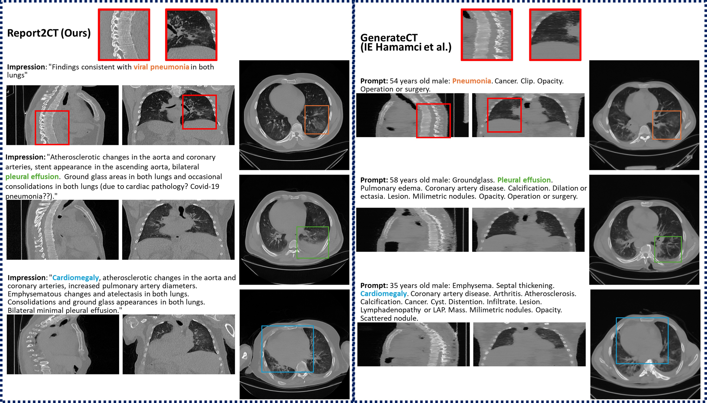

# Report2CT: Radiology Report-Conditional 3D CT Generation

[](LICENSE)
[](https://arxiv.org/abs/2509.14780)
[](https://www.python.org/downloads/release/python-380/)
[](https://pytorch.org/)
[](https://monai.io/)

**Authors:** Sina Amirrajab¹, Zohaib Salahuddin¹, Sheng Kuang¹, Henry C. Woodruff¹˒², Philippe Lambin¹˒²

¹ The D-Lab, Department of Precision Medicine, GROW - Research Institute for Oncology and Reproduction, Maastricht University, 6220 MD Maastricht, The Netherlands

² Department of Radiology and Nuclear Medicine, GROW - Research Institute for Oncology and Reproduction, Maastricht University, Medical Center+, 6229 HX Maastricht, The Netherlands


> 🏆 **Winner of MICCAI 2025 VLM3D Challenge - Task 4: Text-Conditional CT Generation >** [Leaderboard](https://ctgen.vlm3dchallenge.com/evaluation/test/leaderboard/)

## Overview

Report2CT is a radiology report-conditional latent diffusion framework for synthesizing 3D chest CT volumes directly from free-text radiology reports. This repository contains the implementation and research materials for our work that **ranked 1st in Task 4 of the VLM3D Challenge at MICCAI 2025** on Text-Conditional CT Generation.

📄 **Paper**: [arXiv:2509.14780](https://arxiv.org/abs/2509.14780)

## Qualitative Results



**Figure:** Qualitative comparison between our proposed Report2CT model and the GenerateCT model for different abnormalities (lung pneumonia in orange, pleural effusion in green, and cardiomegaly in blue). The red zoomed-in region highlights the consistency of Report2CT across orthogonal views. Both findings and impressions were used for synthesis; for brevity, only impression texts are shown.

## Installation

### Setup
```bash
# Clone the repository
git clone https://github.com/sinaamirrajab/report2ct.git
cd report2ct

# Install dependencies
pip install -r requirements.txt
```

## Quick Start

### 1. Data Preparation

Prepare your CT data and radiology reports in the expected format. The model expects:

- **CT Volumes**: 3D chest CT scans in NIfTI format
- **Radiology Reports**: Free-text reports containing both Findings and Impression sections
- **Metadata**: Voxel spacing information for proper conditioning

### 2. Image Embedding Generation

First, generate image embeddings using the pretrained MAISI VAE-GAN model:

```bash
python -m src.maisi.scripts.vlm3d_image_embedding.py
```

### 3. Training

Train the report-conditional diffusion model:

```bash
torchrun --nproc_per_node=2 -m src.maisi.scripts.diff_model_train_vlm3D_2560_multi_text \
    --env_config ./vlm3D_work_dir/environment_maisi_diff_model_vlm3D_FI_2560_multi.json \
    --model_config ./vlm3D_work_dir/config_maisi_diff_model_vlm3D.json \
    --model_def ./vlm3D_work_dir/config_maisi_2560.json \
    --num_gpus 2
```

### 4. Inference

Use the provided Jupyter notebook for inference:

```bash
vlm3d_inference.ipynb
```


## License

This project is licensed under the **Academic Research License – NonCommercial, No Derivatives**. See the [LICENSE](LICENSE) file for details.


## Citation

If you use Report2CT in your research, please cite our work:

```bibtex
@article{amirrajab2025report2ct,
    title={Report2CT: Radiology Report-Conditional 3D CT Generation with Multi-Encoder Latent-Diffusion Model},
    author={Amirrajab, Sina and Salahuddin, Zohaib and Kuang, Sheng and Woodruff, Henry C. and Lambin, Philippe},
    journal={Medical Image Analysis},
    year={2025},
    note={Winner of MICCAI 2025 VLM3D Challenge - Task 4}
}
```

## Acknowledgments

We thank the organizers of the MICCAI 2025 VLM3D Challenge and the contributors to the CT-RATE dataset. This work was supported by the GROW Research Institute for Oncology and Reproduction at Maastricht University.

---
